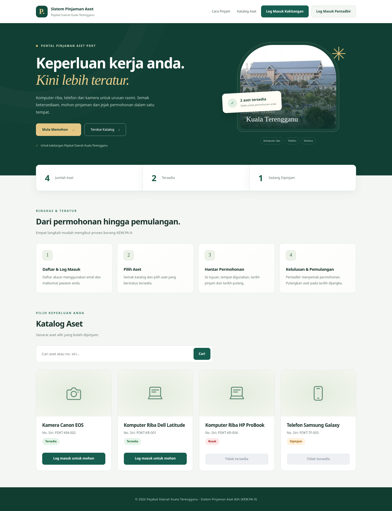

# PDKT — Versi Reka Bentuk Bahasa Melayu

Versi baharu berdasarkan `PDKT.zip` berada dalam folder **[PDKT](PDKT)**. Gunakan folder itu untuk kemas kini sistem Laragon anda.

1. Muat turun ZIP cawangan `reka-bentuk-melayu` dan ekstrak.
2. Buka folder yang diekstrak, kemudian cari folder **PDKT** di dalamnya.
3. Sandarkan folder PDKT sedia ada, kemudian salin kandungan folder PDKT baharu ke `C:\laragon\www\PDKT`.
4. **Kekalkan `dbconnect.php` anda.** Fail tetapan sebenar tidak disertakan. Contoh tetapan tersedia dalam `PDKT/dbconnect.example.php` untuk pemasangan baharu sahaja.
5. Mulakan Laragon dan buka `http://localhost:100/PDKT/`, kemudian tekan **Ctrl + F5**.

Baca **[panduan lengkap](PDKT/PANDUAN.md)**. Tiada import SQL diperlukan untuk kemas kini paparan ini. Fail prototaip lama di akar repositori dikekalkan; gunakan folder PDKT untuk versi baharu ini.

## Pengesahan

Semua fail PHP lulus semakan sintaks. Enam belas pemeriksaan pelayar untuk desktop dan telefon lulus, termasuk pendaftaran, log masuk, katalog, permohonan, navigasi dan kawalan akses. Ujian menggunakan pangkalan data berasingan; data Laragon pengguna tidak diubah.

Halaman pentadbir diperbaharui dari segi paparan. Modul kelulusan dan pengurusan aset belum dilaksanakan dalam fail asal dan masih belum tersedia.
